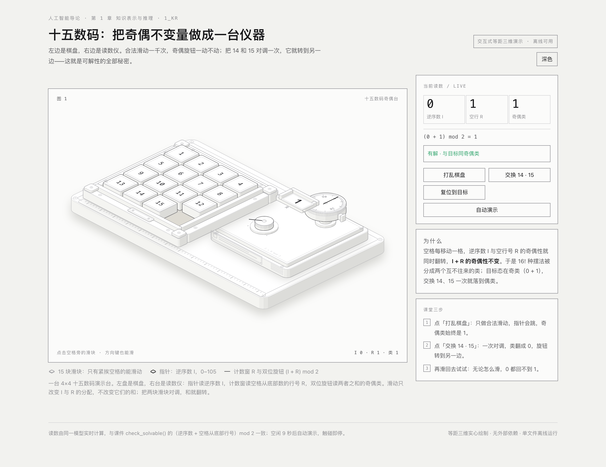

# 十五数码奇偶台 · 交互式三维教学演示

打开 **`shiwu-shuma.html`** 即可使用：单文件、离线、无外部依赖。



## 为什么选这个案例

`1_kr` 里有五个案例：十五数码、猴子与香蕉、修道士与野人、鸟类分类、家族关系。
anatomy 的做法是**把概念做成一台真实的机器**，让机构本身把道理讲出来。后四个案例
是纯状态与规则，没有可以装进机箱的机构；十五数码本身却就是一件实物——一块 4×4
滑块盘。于是这台演示台把它做成「棋盘 + 读数仪」：左边是可以上手滑的滑块盘，右边是
量出「可解性」的三件仪表。

## 画面里的东西

| 部件 | 作用 |
|---|---|
| 15 块带刻字的滑块 + 一个空格 | 棋盘；只有紧挨空格的滑块能滑动，其它滑块会轻抬一下表示被挡住 |
| 表盘（0–105，指针） | 逆序数 I：忽略空格后，前面比后面大的数对个数 |
| 计数窗（R） | 空格从**底部**数在第几行，1–4 |
| 双位旋钮（两个卡位） | 奇偶类 = (I + R) mod 2；指针落在哪一侧的卡位，就是哪一档 |
| 右台铭牌、量尺、通风槽、角码 | 让它像一件仪器，而不是一张示意图 |

关键点：**一次合法滑动只把 I 与 R 的奇偶性互相交换，两者之和不变**，所以旋钮不动；
把 14、15 对调一次（一次对换），旋钮就翻到另一侧，读数变 0，结论变「无解」。

## 操作

- 点击空格旁的滑块，或用方向键（指哪个方向，就让空格那一侧的滑块滑过去）。
- 面板按钮：`打乱棋盘`（只走合法步，所以类始终是 1）、`交换 14 · 15`（把两块抬起互换，
  类翻成 0）、`复位到目标`、`自动演示`。
- 空闲 9 秒后自动演示开始（打乱 → 对调 → 复位，循环），任何触碰都会停下。
- 右上角「深色 / 浅色」切换；`prefers-reduced-motion` 下关闭入场动画与自动演示。

## 读数是真的

读数、指针、计数窗、旋钮都由同一个模型实时算出，和课件 `1_teach_kr.ipynb` 里
`check_solvable()` 的判定完全一致：

```
类 = (逆序数 I + 空格从底部行号 R) mod 2
类 == 1  → 有解（与目标同奇偶类）
类 == 0  → 无解
```

目标盘 `1..15, 空格` 的 I = 0、R = 1，类 = 1；交换 14/15 后 I = 1、R = 1，类 = 0，
与课件里那块 `[..., 13, 15, 14, 0]` 的结论相同。打乱只走合法滑动，所以 I 会跳、类不动。

## 文件

```
1_kr/parity/
├── shiwu-shuma.html   ← 交付物：单文件演示（光/暗两套主题都在里面）
├── build.mjs          ← 生成器：等距几何 + 实时模型 + 页面，node build.mjs 覆盖 HTML
├── kit/               ← anatomy skill 的 iso-kit（MIT）与 inline-kit，构建时用
├── shoot.mjs          ← 本机自测：无头 Chrome 截图（桌面 / 手机 / 深色 / 动作 / 4× 特写）
└── shots/             ← 验证截图
```

重新生成：

```bash
cd 1_kr/parity && node build.mjs
```

自测（本机 Chrome 需要 `--no-sandbox`，脚本已处理）：

```bash
node shoot.mjs shiwu-shuma.html shots/x.png --w 1440 --h 1100
node shoot.mjs shiwu-shuma.html shots/x.png --w 390 --h 900          # 手机
node shoot.mjs shiwu-shuma.html shots/x.png --dark                   # 深色
```

## 已做的检查

- 桌面 1440、手机 390、深色主题、交换后、自动演示中都有截图（`shots/`）。
- 行端点检查：`lines.mjs` 报 `0 of 475 ends on 66 lines float`（没有悬空的线头）。
- 页面控制台无错误、无异常；页面不横向滚动。
- 动画只用缓动跟随，指针与旋钮都是小部件逐帧重建；画面离屏时停帧，静止即停。

## 出处

图形与实时页面由 **anatomy** skill（`~/.codex/skills/anatomy`，MIT）的 `iso-kit` 构建：
所有零件都是实心体，按深度先后绘制，四档明暗由同一套纸面/墨色 token 给出。
本目录只复制了构建所需的 `kit/iso-kit.mjs` 与 `kit/inline-kit.mjs`。
