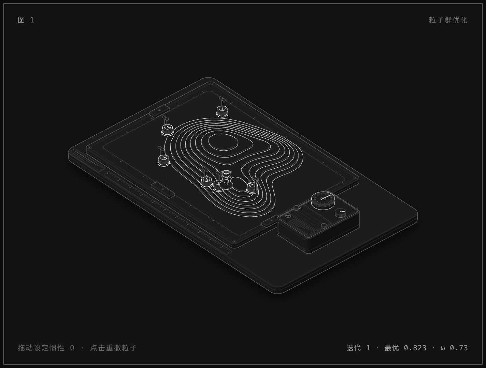

# 粒子群优化 · 搜索绘图台

一张可交互的轴测图，用一台真实的机床来解释粒子群算法（PSO）：等高线台阶是适应度地形，
六枚磁力滑块是粒子，细杆小旗是各自的历史最优，灯塔立在全群最优处，右侧控制台的表盘计迭代、
记录纸画收敛曲线。



## 打开

- `particle-swarm.html` —— 深色主题
- `particle-swarm-light.html` —— 浅色主题

直接双击即可，单文件、无依赖、无网络请求。

## 交互

| 操作 | 作用 |
|---|---|
| 在图上横向拖动 | 设定惯性权重 ω（0.30 – 0.95），旋钮随动 |
| 点击台面 / 空格 / Enter | 重新撒点（下一组种子） |
| ← → ↑ ↓ | ω 微调 0.05 |
| Home / End | ω 到两端 |
| 无操作时 | 自动一轮轮跑：撒点 → 迭代 → 最优不再提升 → 换种子重来 |

`prefers-reduced-motion: reduce` 时不做缓动、不自动跑，只在按键/点击后跳一步（迭代间隔 2.2 s）。

## 图里的每个数字都是真的

`model.mjs` 是唯一的模型，构建脚本和网页**跑同一份代码**：

- 适应度：三个二维高斯之和，在 300 × 212 的地形场内归一化到 0 – 1；主峰在左，右前一处次峰，后方一处小丘。
- 等高线：`contour.mjs` 用 marching squares 在 1.6 单位网格上取水平集，RDP 简化后按 5 单位重采样；
  9 条等高线切出 9 层台阶，层高 2.3 单位。台阶就是等高线本身——台面的边缘正是那条水平集曲线。
- 粒子：标准全局最优 PSO，`v ← ωv + c₁r₁(p − x) + c₂r₂(g − x)`，`x ← x + v`，
  `c₁ = c₂ = 1.49618`，速度上限 34，六枚滑块，随机数由种子确定。
- 读数：滑块的台阶级数 = 它所在位置的适应度所在层；表盘 30 代转一圈；记录纸是 `gbest` 历史；
  灯塔、小旗由模型里的 `gbest` / `pbest` 驱动。
- 收敛：`gbest` 连续 9 代没有实质提升（< 1e-4）即判收敛，与记录纸走平的那一段一致。

## 文件

```
model.mjs        适应度场 + PSO + 种子（构建与网页共用）
contour.mjs      marching squares，生成等高线闭合环（仅构建时用）
build.mjs        画法：底座、台板、地形台阶、滑块、小旗、灯塔、控制台 + 实时脚本 + 页面
kit/iso-kit.mjs  Anatomy 轴测工具包（相机、实体、卡片、页面、CSS）
particle-swarm.html / -light.html   产物
shots/           截图与校验留档
```

重新构建：

```sh
node build.mjs            # 深色
node build.mjs --light    # 浅色
```

## 校验

- 线条端点检查（`scripts/lines.mjs`）：两套主题都是 `line ends: 0 of 906 ends on 74 lines float`。
- 页面控制台无报错、无横向滚动；桌面 1440 与手机 390（图形放大 114%）均正常。
- 图形包围盒 `[71,57,518,329]`（viewBox 660 × 430），居中、不越界，四周留白足够。
- 7 个标记（6 滑块 + 灯塔）与 6 面小旗都在台面上；被地形挡住的滑块按真实遮挡隐藏。

`shots/` 里的 PNG 用技能自带的 `capture.mjs` / `drive.mjs` / `lines.mjs` 生成。
本机的 Chrome 在沙箱下需要 `--no-sandbox`，`shots/chrome-wrap.sh` 就是那个壳：

```sh
CHROME_PATH="$PWD/shots/chrome-wrap.sh" node <skill>/scripts/capture.mjs particle-swarm.html --out shots/desk.png
```

## 备注

图由 [Anatomy](https://github.com/) 技能的方法与工具包绘制（轴测相机、四阶明暗、画家排序、卡片版式）。
所有零件都落在别的零件上，每条线都收在笔画、圆点或轮廓上。
